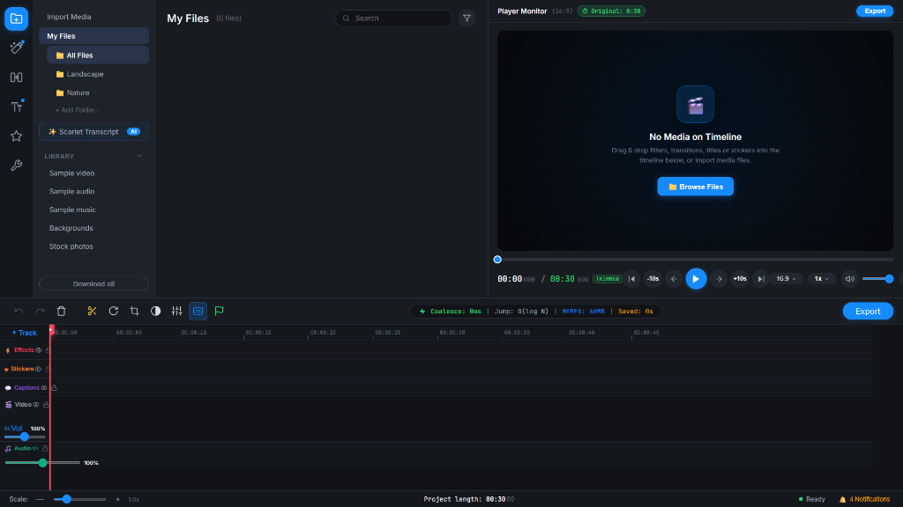
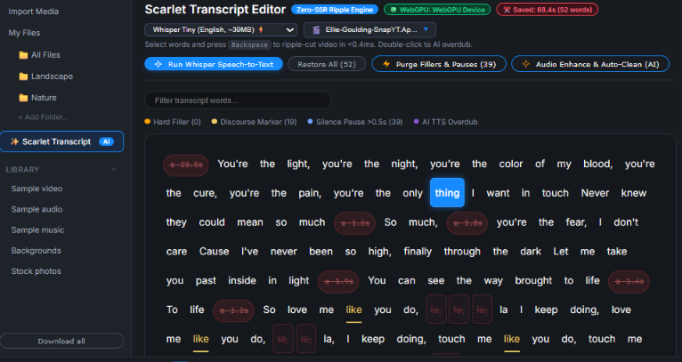
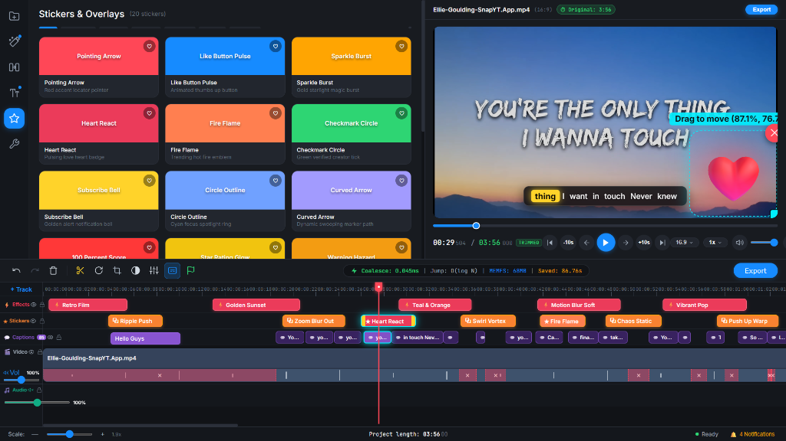
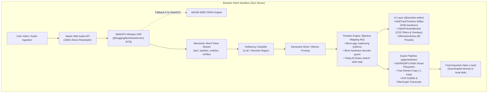

# ScarletCut 🎬

<div align="center">

### **Decentralized, 100% Client-Side Non-Linear Video Editor**
**Powered by In-Browser WebGPU Whisper ASR, Bijective Ripple Timeline Engine & WebAssembly FFmpeg**

[](https://www.typescriptlang.org/)
[](https://react.dev/)
[](https://vitejs.dev/)
[](https://www.w3.org/TR/webgpu/)
[](https://ffmpeg.org/)
[](#-getting-started--local-development)
[](LICENSE)

<br />

<p align="center">
  <a href="#-quick-tour--feature-showcase">Feature Tour</a> •
  <a href="#-why-scarletcut-vs-cloud-editors">Why ScarletCut?</a> •
  <a href="#-architectural-overview--data-flow">Architecture</a> •
  <a href="#-keyboard-shortcuts">Hotkeys</a> •
  <a href="#-technology-stack">Tech Stack</a> •
  <a href="#-performance-benchmarks--self-healing-runtime">Benchmarks</a> •
  <a href="#-getting-started--local-development">Getting Started</a>
</p>

---



*ScarletCut running 100% in-browser: clean, distraction-free non-linear editing studio with media library, dual-timecode monitor, and 5-track timeline.*

</div>

<br />

## 🌟 Executive Summary: What is ScarletCut?

**ScarletCut** is a high-performance, decentralized non-linear video editor (NLE) engineered from the ground up to run entirely within the user's web browser. 

Traditional video editing workflows are notoriously tedious: scrubbing through hours of footage to manually snip pauses, disfluencies, and bad takes. Existing AI-assisted video editors require expensive cloud subscriptions and compromise privacy by uploading sensitive video and audio to third-party servers.

> [!IMPORTANT]  
> **100% Privacy by Design**: All speech transcription, video decoding, timeline transformations, and video exports run entirely on your local machine. No media files, audio buffers, or transcripts are ever transmitted to any remote server or cloud API.

**Key Pillars of ScarletCut:**
- **Zero Cloud Compute Costs**: No API keys, no server queues, and no subscription paywalls ($0 infrastructure overhead).
- **Sub-Millisecond Text-Driven Editing**: Edit video simply by editing text. Deleting a word or silence interval in the transcript triggers a non-destructive virtual ripple cut in **$<0.4\text{ms}$** without re-encoding.
- **Hardware-Accelerated In-Browser ML**: Leverages **WebGPU INT8 Whisper** inference with automatic SIMD WebAssembly CPU fallback.
- **Multi-Track Compositing with 60fps Playhead**: Direct DOM transform mutations bypass React's virtual DOM reconciliation loop during playback and scrubber scrubbing.
- **Client-Side Export**: High-speed local video rendering via **FFmpeg WebAssembly** with zero-copy `WORKERFS` RAM mounts and stream-copy fast-paths.

---

## ⚖️ Why ScarletCut? vs Cloud Editors

| Capability | **ScarletCut** (In-Browser) | Descript | CapCut Web | Traditional NLEs (Premiere / Resolve) |
| :--- | :---: | :---: | :---: | :---: |
| **Server / Cloud Dependency** | 🟢 **0% (100% Local)** | 🔴 Heavy Cloud Upload | 🔴 Cloud Ingestion | 🟢 Local Only |
| **Privacy & Data Security** | 🔒 **Zero Data Leaves Device** | ⚠️ Transcripts Sent to Cloud | ⚠️ Server Storage | 🔒 Local Storage |
| **Pricing / Subscription** | 💸 **Free & Open Source ($0)** | 💳 $24 – $40 / month | 💳 Freemium Paywalls | 💳 $20 – $300+ |
| **Text-Driven Ripple Cuts** | ⚡ **$<0.4\text{ms}$ Virtual Leap** | ⏱️ Cloud Re-Sync | ❌ Manual Cuts Only | ❌ Manual Cuts Only |
| **On-Device Whisper ASR** | ⚡ **Direct GPU INT8 Inference** | ❌ Server-Side Speech API | ❌ Server-Side Speech API | ❌ Cloud / Native Only |
| **Micro-Gap Coalescing** | 🛡️ **$\le 85\text{ms}$ Auto-Merge** | ⚠️ Variable | ❌ Manual | ❌ Manual |
| **Export Architecture** | 🚀 **WebAssembly + WORKERFS** | ⏱️ Cloud Queue Rendering | ⏱️ Server Queue Rendering | 🚀 Native GPU NVENC/VCE |

---

## 📸 Quick Tour & Feature Showcase

### 1. Text-Driven Video Editing & WebGPU Whisper ASR
Select words, phrases, or dead-air silences directly in the interactive transcript and press <kbd>Backspace</kbd> to ripple-cut the footage instantaneously.

<div align="center">
  
  <p><em>ScarletCut Transcript Editor: WebGPU device status, silence gap pills (#20.59s), filler word classification, and single-click AI purge actions.</em></p>
</div>

- **WebGPU Local Whisper**: Transcribes speech locally using `@huggingface/transformers` with sub-word timestamp monotonicity alignment.
- **Acoustic Silence Segmentation**: Automatically detects natural speaking pauses and displays them as interactive silence pills (e.g., `# 20.59s`, `# 1.63s`).
- **One-Click Disfluency & Pause Purge**: Detects lexical fillers (*"um"*, *"uh"*, *"er"*), discourse markers (*"like"*, *"you know"*), and dead air, pruning them while preserving 120ms of acoustic breathing room.
- **Live Trimming Savings**: Realtime counter computes exact saved duration and word reduction (e.g., `Saved: 68.4s (52 words)`).

---

### 2. Professional Multi-Track Timeline & Realtime Monitor
A fluid, multi-layered non-linear timeline built for smooth 60fps scrubbing and frame-by-frame cuts.

<div align="center">
  
  <p><em>Active multi-track editing session: live video playback with kinetic typography, on-monitor draggable sticker overlays, and dynamic multi-layer clips on Video, Audio, Captions, Stickers, and Effects tracks.</em></p>
</div>

- **5 Dedicated Timeline Tracks**:
  - 🎨 **Effects & Filters Track**: Non-destructive color grades and cinematic looks.
  - ⭐ **Stickers & Graphics Track**: Interactive overlays with transform controls.
  - 💬 **Captions & Kinetic Typography Track**: Word-timed karaoke and headline titles.
  - 🎬 **Primary Video Track**: Video slices, ripple segments, split points, and cut markers.
  - 🔊 **Audio Track**: Independent volume faders, mute/solo toggles, and ducking envelopes.
- **Buttery 60fps Playhead**: Direct DOM transform mutations bypass React's virtual DOM reconciliation loop during playback and scrubber scrubbing.
- **Dynamic Scale Zoom ($0.2\times$ to $3.5\times$)**: Calibrated base density of $12\text{px/s}$ allows overviewing 10–30+ minute takes in a single view, with dynamic ruler tick intervals ($2\text{s}, 5\text{s}, 10\text{s}, 15\text{s}$) to prevent label collisions.
- **Magnetic Snapping**: Cyan vertical snap guidelines snap playhead and clips to exact clip boundaries and marker points.
- **Dual-Timecode Architecture**: Displays both the original raw video duration (e.g. `Original: 3:56`) and the current active trimmed runtime (e.g. `00:29.50 / 03:56.00 TRIMMED`).

---

### 3. Curated Creative Assets Library (80 Presets)
ScarletCut includes a built-in production rack of 80 hand-crafted, GPU-accelerated presets:

| Category | Count | Highlights & Styling |
| :--- | :---: | :--- |
| **Cinematic Filters** | **20** | Cyberpunk Teal & Orange, Noir 1940s, Golden Sunset, 90s Camcorder VHS, Matrix Green, Kodachrome, Emerald Dream, Arctic Frost, Pastel Dream, High Contrast B&W, Sepia Antique, Sunset Heat, Synthwave Violet, Forest Glade, Urban Desat, Crimson Tint, Soft Bloom, Vivid Pop, Twilight Blue, Retro Film. |
| **Transitions** | **20** | Ripple Push, Zoom Blur Out, Swirl Vortex, Chaos Static, Push Up Warp, Film Burn Dissolve, Whip Pan, Cross Dissolve, Glitch Twitch, Light Leak Flash, Horizontal Slide, Spin Wipe, and more. |
| **Kinetic Titles** | **20** | Word Karaoke Sync, Typewriter Pulse, Bold Punch, Glow Fade, Glitch Pop, Neon Flicker, Minimal Slide, Lower Third Banner, Cinematic Fade, and more. |
| **Interactive Stickers** | **20** | Pointing Arrow, Like Button Pulse, Sparkle Burst, Heart React, Fire Flame, Checkmark Circle, Subscribe Bell, Circle Spotlight, Curved Arrow, 100% Score, Warning Hazard, and more. |

- **On-Screen Interactive Canvas Manipulation**: Drag stickers directly on top of the preview video with real-time coordinate badges (`Drag to move (87.1%, 76.7%)`), scale resizing handles, and instant delete badges.

---

## ⌨️ Keyboard Shortcuts

Speed up your editing workflow with intuitive keyboard hotkeys:

| Shortcut | Action | Description |
| :--- | :--- | :--- |
| <kbd>Space</kbd> | **Play / Pause** | Toggle video and audio playback |
| <kbd>Backspace</kbd> / <kbd>Delete</kbd> | **Ripple Cut Word** | Prune selected word or silence interval in $<0.4\text{ms}$ |
| <kbd>Ctrl</kbd> + <kbd>Scroll</kbd> | **Timeline Zoom** | Smooth zoom in / out between $0.2\times$ and $3.5\times$ |
| <kbd>Shift</kbd> + <kbd>Scroll</kbd> | **Horizontal Pan** | Pan left or right across the multi-track timeline |
| <kbd>J</kbd> / <kbd>K</kbd> / <kbd>L</kbd> | **Shuttle Transport** | Rewind, pause, or fast-forward playback |
| <kbd>S</kbd> | **Split Clip** | Slice selected clip cleanly at playhead timestamp |
| <kbd>M</kbd> | **Mute Track** | Toggle audio mute for the targeted channel |
| <kbd>L</kbd> | **Lock Track** | Prevent accidental edits or shifts on locked tracks |

---

## 🏗 Architectural Overview & Data Flow

ScarletCut is architected as an isolated monorepo separating mathematical NLE algorithms from UI components and runtime orchestrators.



### Monorepo Packages Breakdown

```text
scarlet-rewrite/
├── packages/
│   ├── BACKEND-CORE/        # Zero-DOM pure TypeScript mathematical NLE engine
│   │   ├── src/
│   │   │   ├── timelineEngine.ts              # Bijective Φ(τ), binary search leaps, ripple cuts
│   │   │   ├── fillerAndWhisper.ts            # Monotonic token alignment, silence detection, Whisper factory
│   │   │   ├── filterGraphBuilder.ts          # FFmpeg -filter_complex builder & ASS subtitle scripts
│   │   │   ├── disfluencyCutter.ts            # Sequence tagger, local LLM client & phonetic heuristics
│   │   │   └── multiTrackAndAudioEnhancement.ts # B-roll anchors, audio ducking, vocal DSP (85Hz HPF)
│   │   └── test/                              # 46 automated unit & regression tests
│   └── UI/                  # High-density dark-mode React 18 component library
│       └── src/
│           ├── components/
│           │   ├── timeline/MultiTrackTimeline.tsx   # 5-track timeline, 60fps playhead, magnetic snap
│           │   ├── player/VideoPreviewMonitor.tsx    # Real-time player, draggable overlays, CSS filters
│           │   ├── workspace/EffectsGridView.tsx     # 80 curated presets (filters, transitions, stickers)
│           │   ├── transcript/TranscriptEditor.tsx   # Interactive word tokens, silence pills, AI purge
│           │   └── layout/StatusFooter.tsx           # Zoom controls (0.2x–3.5x), project timecodes
├── apps/                    # Vite client application orchestrator
│   └── src/
│       ├── App.tsx                            # Root application state & keyboard shortcuts
│       └── export/wasmExporter.ts             # FFmpeg WebAssembly compiler with WORKERFS RAM mount
└── docs/images/             # High-resolution screenshots and architectural media
```

---

## ⚡ Technology Stack

| Layer | Technology | Version | Purpose & Architectural Role |
| :--- | :--- | :---: | :--- |
| **Language** | TypeScript | `^5.7.3` | Strict mode (`noImplicitAny`, `noUncheckedIndexedAccess`) across monorepo |
| **UI Framework** | React | `^18.3.1` | Component lifecycle, custom hooks, and state presentation |
| **Bundler & Server** | Vite | `^6.0.7` | Blazing-fast HMR with COOP/COEP cross-origin isolation headers |
| **State Management** | Zustand | `^5.0.16` | Transient, zero-re-render audio/playback updates |
| **AI / Machine Learning** | `@huggingface/transformers` | `^4.3.1` | In-browser WebGPU Whisper ASR and ONNX sequence classification |
| **Media Transcoding** | `@ffmpeg/ffmpeg` | `^0.12.15` | Client-side WebAssembly video demuxing, concat, and stream encoding |
| **Virtual Filesystem** | Emscripten `WORKERFS` | — | Zero-copy mounting of `File`/`Blob` objects directly into WASM RAM |
| **Audio DSP** | Web Audio API | Standard | 16kHz mono resampling, 85Hz vocal high-pass filter, RMS noise gate |
| **Test Runner** | Node.js `tsx --test` | `^4.23.15` | Native sub-millisecond TypeScript test suite execution |
| **Package Manager** | pnpm Workspaces | `^9.0.0` | Monorepo dependency linking and atomic build scripts |

---

## 🛡 Performance Benchmarks & Self-Healing Runtime

| Metric / Boundary Condition | Benchmark / Guarantee | Architectural Mechanism |
| :--- | :---: | :--- |
| **Virtual Timeline Seek Leap** | **$<0.4\text{ms}$** ($O(\log N)$) | Binary search over coalesced segments with boundary $\epsilon$ clamping |
| **Playhead Scrubber Rendering** | **60 FPS** (Buttery Smooth) | Direct DOM transform mutations bypassing React reconciliation |
| **Acoustic Micro-Gap Coalesce** | $\le 85\text{ms}$ | Merges rapid intra-word micro-silences into continuous audio |
| **Hardware Decoder Stall Guard** | $\ge 30\text{ms}$ minimum cut | Filters sliver segments to eliminate media decoder freeze / black frames |
| **WASM Linear Memory Protection** | $<750\text{MB}$ heap footprint | Deterministic `ffmpeg.deleteFile()` and zero-copy `WORKERFS` mounts |
| **WebGPU Context Recovery** | $100\%$ Fallback Guarantee | Seamlessly switches to multi-threaded SIMD CPU WASM if GPU drops |
| **Cross-Origin Isolation** | `COOP: same-origin`<br />`COEP: credentialless` | Unlocks `SharedArrayBuffer` threading without third-party asset blocking |

---

## 🚀 Getting Started & Local Development

### Prerequisites
- **Node.js**: `20.x` or higher
- **pnpm**: `9.x` or higher (recommended) or `npm`
- **Modern Web Browser**: Chrome 113+, Edge 113+, or Chromium browser with WebGPU enabled (`chrome://flags/#enable-unsafe-webgpu` for early builds)

### 1. Clone & Install Dependencies
```bash
git clone https://github.com/aksjc2023-code/scarlet-rewrite.git
cd scarlet-rewrite

# Install dependencies across all monorepo packages
pnpm install
```

### 2. Run Automated Verification Tests
```bash
# Run the 46 unit & integration tests
pnpm test
```

### 3. Start Development Server
```bash
pnpm dev
```
Open [http://localhost:5173](http://localhost:5173) in your browser. The Vite server automatically applies:
- `Cross-Origin-Opener-Policy: same-origin`
- `Cross-Origin-Embedder-Policy: credentialless`

### 4. Build for Production
```bash
pnpm build
```

---

## 🗺 Roadmap & Future Horizons

- [x] WebGPU Whisper Speech-to-Text inference with local INT8 quantization
- [x] Bijective piecewise-linear virtual timeline mapping engine ($O(\log N)$ seeks)
- [x] 5-track non-linear timeline with 60fps playhead and volume automation
- [x] 80 hand-crafted presets: 20 Filters, 20 Transitions, 20 Titles, 20 Stickers
- [x] Interactive on-monitor canvas overlay manipulation (drag, scale, position)
- [x] Automated filler word & silence pause detection with single-click purge
- [x] Stream-copy (`-c copy`) and filtergraph WebAssembly export with `WORKERFS`
- [ ] Multi-speaker diarization via in-browser PyAnnote ONNX runtime
- [ ] Canvas-based motion tracking for stick-to-face sticker attachments
- [ ] Export directly to DaVinci Resolve EDL / Final Cut Pro XML (`.fcpxml`)

---

## 📄 License

This project is licensed under the **MIT License**. See the [LICENSE](LICENSE) file for complete details.

<div align="center">
  <sub>Engineered with precision for Webster 2026. Made with ❤️ by the ScarletCut Team.</sub>
</div>
