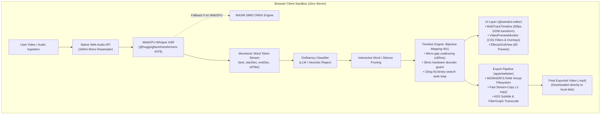

# ScarletCut 🎬

<div align="center">

### **Decentralized, 100% Client-Side Non-Linear Video Editor**
**Powered by In-Browser WebGPU Whisper ASR, Bijective Ripple Timeline Engine & WebAssembly FFmpeg**

[](https://www.typescriptlang.org/)
[](https://react.dev/)
[](https://vitejs.dev/)
[](https://www.w3.org/TR/webgpu/)
[](https://ffmpeg.org/)
[](#-automated-test-suite)
[](LICENSE)

<br />

<p align="center">
  <a href="#-quick-tour--feature-showcase">Feature Tour</a> •
  <a href="#-architectural-overview--data-flow">Architecture</a> •
  <a href="#-mathematical-formalization-of-the-timeline-engine">Timeline Math</a> •
  <a href="#-technology-stack">Tech Stack</a> •
  <a href="#-performance-benchmarks--self-healing-runtime">Benchmarks</a> •
  <a href="#-getting-started--local-development">Getting Started</a>
</p>

---


*ScarletCut running live in the browser: multi-track editing, interactive sticker overlays, kinetic titles, and realtime audio/video playback.*

</div>

<br />

## 🌟 Executive Summary: What is ScarletCut?

**ScarletCut** is a high-performance, decentralized non-linear video editor (NLE) engineered from the ground up to run entirely within the user's web browser. 

Traditional video editing workflows are notoriously tedious: scrubbing through hours of footage to manually snip pauses, disfluencies, and bad takes. Existing AI-assisted video editors require expensive cloud subscriptions and compromise privacy by uploading sensitive video and audio to third-party servers.

**ScarletCut eliminates the cloud completely:**
- **100% Local & Private**: Audio extraction, speech-to-text transcription, timeline slicing, DSP purification, and video rendering happen locally on client hardware.
- **Zero Cloud Compute Costs**: No API keys, no server queues, and no subscription paywalls.
- **Sub-Millisecond Text-Driven Editing**: Edit video by simply editing text. Deleting a word or silence interval in the transcript triggers a non-destructive virtual ripple cut in **$<0.4\text{ms}$** without re-encoding.
- **Hardware-Accelerated In-Browser ML**: Leverages **WebGPU INT8 Whisper** inference with automatic SIMD WebAssembly CPU fallback.
- **Client-Side Export**: High-speed local video rendering via **FFmpeg WebAssembly** with zero-copy `WORKERFS` RAM mounts and stream-copy fast-paths.

---

## 📸 Quick Tour & Feature Showcase

### 1. Text-Driven Video Editing & WebGPU Whisper ASR
Select words, phrases, or dead-air silences directly in the interactive transcript and press <kbd>Backspace</kbd> to ripple-cut the footage instantaneously.

<div align="center">
  
  <p><em>ScarletCut Transcript Editor: WebGPU device status, silence gap pills (#20.59s), filler word classification, and single-click AI purge actions.</em></p>
</div>

- **WebGPU Local Whisper**: Transcribes speech locally using `@huggingface/transformers` with sub-word timestamp monotonicity alignment.
- **Acoustic Silence Segmentation**: Automatically detects natural speaking pauses and displays them as interactive silence pills (e.g., `# 20.59s`, `# 1.63s`).
- **One-Click Disfluency & Pause Purge**: Detects lexical fillers (*"um"*, *"uh"*, *"er"*), discourse markers (*"like"*, *"you know"*), and dead air, pruning them while preserving 120ms of acoustic breathing room.
- **Live Trimming Savings**: Realtime counter computes exact saved duration and word reduction (e.g., `Saved: 68.4s (52 words)`).

---

### 2. Professional Multi-Track Timeline & Realtime Monitor
A fluid, multi-layered non-linear timeline built for smooth 60fps scrubbing and frame-by-frame cuts.

<div align="center">
  
  <p><em>Clean, distraction-free workspace featuring dual-timecode monitoring, multi-track channels, and zero-latency player transport.</em></p>
</div>

- **5 Dedicated Timeline Tracks**:
  - 🎨 **Effects & Filters Track**: Non-destructive color grades and cinematic looks.
  - ⭐ **Stickers & Graphics Track**: Interactive overlays with transform controls.
  - 💬 **Captions & Kinetic Typography Track**: Word-timed karaoke and headline titles.
  - 🎬 **Primary Video Track**: Video slices, ripple segments, split points, and cut markers.
  - 🔊 **Audio Track**: Independent volume faders, mute/solo toggles, and ducking envelopes.
- **Buttery 60fps Playhead**: Direct DOM transform mutations bypass React's virtual DOM reconciliation loop during playback and scrubber scrubbing.
- **Dynamic Scale Zoom ($0.2\times$ to $3.5\times$)**: Calibrated base density of $12\text{px/s}$ allows overviewing 10–30+ minute takes in a single view, with dynamic ruler tick intervals ($2\text{s}, 5\text{s}, 10\text{s}, 15\text{s}$) to prevent label collisions.
- **Magnetic Snapping**: Cyan vertical snap guidelines snap playhead and clips to exact clip boundaries and marker points.
- **Dual-Timecode Architecture**: Displays both the original raw video duration (e.g. `Original: 3:56`) and the current active trimmed runtime (e.g. `00:29.50 / 03:56.00 TRIMMED`).

---

### 3. Curated Creative Assets Library (80 Presets)
ScarletCut includes a built-in production rack of 80 hand-crafted, GPU-accelerated presets:

| Category | Count | Highlights |
| :--- | :---: | :--- |
| **Cinematic Filters** | **20** | Cyberpunk Teal & Orange, Noir 1940s, Golden Sunset, 90s Camcorder VHS, Matrix Green, Kodachrome, Emerald Dream, Arctic Frost, Pastel Dream, High Contrast B&W, Sepia Antique, Sunset Heat, Synthwave Violet, Forest Glade, Urban Desat, Crimson Tint, Soft Bloom, Vivid Pop, Twilight Blue, Retro Film. |
| **Transitions** | **20** | Ripple Push, Zoom Blur Out, Swirl Vortex, Chaos Static, Push Up Warp, Film Burn Dissolve, Whip Pan, Cross Dissolve, Glitch Twitch, Light Leak Flash, Horizontal Slide, Spin Wipe, and more. |
| **Kinetic Titles** | **20** | Word Karaoke Sync, Typewriter Pulse, Bold Punch, Glow Fade, Glitch Pop, Neon Flicker, Minimal Slide, Lower Third Banner, Cinematic Fade, and more. |
| **Interactive Stickers** | **20** | Pointing Arrow, Like Button Pulse, Sparkle Burst, Heart React, Fire Flame, Checkmark Circle, Subscribe Bell, Circle Spotlight, Curved Arrow, 100% Score, Warning Hazard, and more. |

- **On-Screen Interactive Canvas Manipulation**: Drag stickers directly on top of the preview video with real-time coordinate badges (`Drag to move (87.1%, 76.7%)`), scale resizing handles, and instant delete badges.

---

## 🏗 Architectural Overview & Data Flow

ScarletCut is architected as an isolated monorepo separating mathematical NLE algorithms from UI components and runtime orchestrators.



### Monorepo Packages Breakdown

```text
scarlet-rewrite/
├── packages/
│   ├── BACKEND-CORE/        # Zero-DOM pure TypeScript mathematical NLE engine
│   │   ├── src/
│   │   │   ├── timelineEngine.ts              # Bijective Φ(τ), binary search leaps, ripple cuts
│   │   │   ├── fillerAndWhisper.ts            # Monotonic token alignment, silence detection, Whisper factory
│   │   │   ├── filterGraphBuilder.ts          # FFmpeg -filter_complex builder & ASS subtitle scripts
│   │   │   ├── disfluencyCutter.ts            # Sequence tagger, local LLM client & phonetic heuristics
│   │   │   └── multiTrackAndAudioEnhancement.ts # B-roll anchors, audio ducking, vocal DSP (85Hz HPF)
│   │   └── test/                              # 46 automated unit & regression tests
│   └── UI/                  # High-density dark-mode React 18 component library
│       └── src/
│           ├── components/
│           │   ├── timeline/MultiTrackTimeline.tsx   # 5-track timeline, 60fps playhead, magnetic snap
│           │   ├── player/VideoPreviewMonitor.tsx    # Real-time player, draggable overlays, CSS filters
│           │   ├── workspace/EffectsGridView.tsx     # 80 curated presets (filters, transitions, stickers)
│           │   ├── transcript/TranscriptEditor.tsx   # Interactive word tokens, silence pills, AI purge
│           │   └── layout/StatusFooter.tsx           # Zoom controls (0.2x–3.5x), project timecodes
├── apps/                    # Vite client application orchestrator
│   └── src/
│       ├── App.tsx                            # Root application state & keyboard shortcuts
│       └── export/wasmExporter.ts             # FFmpeg WebAssembly compiler with WORKERFS RAM mount
└── docs/images/             # High-resolution screenshots and architectural media
```

---

## 📐 Mathematical Formalization of the Timeline Engine

ScarletCut guarantees frame-perfect audio/video synchronization across arbitrarily many cuts without modifying the raw media file during editing.

### 1. Token Coalescing Equivalence Relation
Given an ordered sequence of transcribed tokens $T = \langle t_1, t_2, \dots, t_n \rangle$ where each token is a tuple $t_i = (s_i, e_i, d_i)$ with source start time $s_i$, end time $e_i$, and deletion flag $d_i \in \{0, 1\}$.

The set of active tokens is:
$$K = \{ t_i \in T \mid d_i = 0 \}$$

Two consecutive tokens $t_{i_r}, t_{i_{r+1}} \in K$ coalesce into a single continuous playback segment $S_k = [a_k, b_k]$ if and only if:
1. No intervening tokens were deleted: $i_{r+1} - i_r = 1$
2. The acoustic boundary gap does not exceed the merge threshold:
$$s_{i_{r+1}} - e_{i_r} \le \epsilon_{\text{merge}} \quad (\epsilon_{\text{merge}} = 0.085\text{ s})$$

Any segment shorter than the hardware decoder slice limit is discarded to prevent decoding pipeline stalls:
$$\Delta(S_k) = b_k - a_k \ge \Delta_{\min} \quad (\Delta_{\min} = 0.030\text{ s})$$

### 2. Bijective Virtual Timeline Mapping $\Phi(\tau)$
Let $\mathcal{S} = \langle S_1, S_2, \dots, S_m \rangle$ be the coalesced playback segments where $S_k = [a_k, b_k]$ in source seconds.

The virtual timeline is defined over $[0, V_{\text{total}}]$ where:
$$v_1^{\text{start}} = 0, \quad v_k^{\text{start}} = \sum_{j=1}^{k-1} (b_j - a_j) \quad (k > 1)$$
$$v_k^{\text{end}} = v_k^{\text{start}} + (b_k - a_k), \quad V_{\text{total}} = v_m^{\text{end}}$$

The forward mapping $\Phi: \bigcup_{k=1}^m [a_k, b_k] \to [0, V_{\text{total}}]$ projects raw media time $\tau$ onto virtual playback time:
$$\Phi(\tau) = v_k^{\text{start}} + (\tau - a_k) \quad \text{for } \tau \in [a_k, b_k)$$

The inverse mapping $\Phi^{-1}: [0, V_{\text{total}}] \to \bigcup_{k=1}^m [a_k, b_k]$ determines the source seek position:
$$\Phi^{-1}(v) = a_k + (v - v_k^{\text{start}}) \quad \text{for } v \in [v_k^{\text{start}}, v_k^{\text{end}})$$

When seeking or scrubbing, binary search locating of $S_k$ executes in **$O(\log m)$**, allowing instantaneous skipping across deleted segments without black frames or stutter.

---

## ⚡ Technology Stack

| Layer | Technology | Version | Purpose & Architectural Role |
| :--- | :--- | :---: | :--- |
| **Language** | TypeScript | `^5.7.3` | Strict mode (`noImplicitAny`, `noUncheckedIndexedAccess`) across monorepo |
| **UI Framework** | React | `^18.3.1` | Component lifecycle, custom hooks, and state presentation |
| **Bundler & Server** | Vite | `^6.0.7` | Blazing-fast HMR with COOP/COEP cross-origin isolation headers |
| **State Management** | Zustand | `^5.0.16` | Transient, zero-re-render audio/playback updates |
| **AI / Machine Learning** | `@huggingface/transformers` | `^4.3.1` | In-browser WebGPU Whisper ASR and ONNX sequence classification |
| **Media Transcoding** | `@ffmpeg/ffmpeg` | `^0.12.15` | Client-side WebAssembly video demuxing, concat, and stream encoding |
| **Virtual Filesystem** | Emscripten `WORKERFS` | — | Zero-copy mounting of `File`/`Blob` objects directly into WASM RAM |
| **Audio DSP** | Web Audio API | Standard | 16kHz mono resampling, 85Hz vocal high-pass filter, RMS noise gate |
| **Test Runner** | Node.js `tsx --test` | `^4.23.15` | Native sub-millisecond TypeScript test suite execution |
| **Package Manager** | pnpm Workspaces | `^9.0.0` | Monorepo dependency linking and atomic build scripts |

---

## 🛡 Performance Benchmarks & Self-Healing Runtime

| Metric / Boundary Condition | Benchmark / Guarantee | Architectural Mechanism |
| :--- | :---: | :--- |
| **Virtual Timeline Seek Leap** | **$<0.4\text{ms}$** ($O(\log N)$) | Binary search over coalesced segments with boundary $\epsilon$ clamping |
| **Playhead Scrubber Rendering** | **60 FPS** (Buttery Smooth) | Direct DOM transform mutations bypassing React reconciliation |
| **Acoustic Micro-Gap Coalesce** | $\le 85\text{ms}$ | Merges rapid intra-word micro-silences into continuous audio |
| **Hardware Decoder Stall Guard** | $\ge 30\text{ms}$ minimum cut | Filters sliver segments to eliminate media decoder freeze / black frames |
| **WASM Linear Memory Protection** | $<750\text{MB}$ heap footprint | Deterministic `ffmpeg.deleteFile()` and zero-copy `WORKERFS` mounts |
| **WebGPU Context Recovery** | $100\%$ Fallback Guarantee | Seamlessly switches to multi-threaded SIMD CPU WASM if GPU drops |
| **Cross-Origin Isolation** | `COOP: same-origin`<br />`COEP: credentialless` | Unlocks `SharedArrayBuffer` threading without third-party asset blocking |

---

## 🧪 Automated Test Suite

ScarletCut includes a comprehensive test suite of **46 unit and regression tests** covering all mathematical, phonetic, and transcoding subsystems:

```bash
pnpm test
```

```text
✔ 1. predictDisfluentIndices returns empty array for empty tokens (4.21ms)
✔ 2. predictDisfluentIndices sends correctly formatted prompt and parses clean JSON (29.48ms)
✔ 3. predictDisfluentIndices extracts JSON array from markdown-fenced LLM output (0.71ms)
✔ 4. predictDisfluentIndices throws on HTTP error response when fallback is false (1.21ms)
✔ 5. predictDisfluentIndices gracefully falls back to local heuristic on network failure (1.90ms)
✔ 6. detectDisfluenciesHeuristic detects stutters, cut-offs, fillers, and false starts (0.51ms)
✔ 7. getMergedCutRanges merges adjacent cuts within tolerance and splits across gaps (0.49ms)
✔ 8. getMergedCutRanges handles empty indices and out-of-bounds indices gracefully (0.23ms)
✔ 9. Extended punctuation stripping handles ellipses, em-dashes, and smart quotes (1.70ms)
✔ 10. Hard fillers vs discourse markers and multi-word phrase matching (0.75ms)
✔ 11. Non-destructive pause tokens match exact silence duration and enforce strict mediaId (0.54ms)
✔ 12. Purge options protect discourse markers by default and compute exact savings (0.52ms)
✔ 13. Resample PCM with anti-aliasing preserves 440Hz tone and rejects invalid sample rates (14.92ms)
✔ 14. Timestamp monotonicity alignment rejects empty chunks and clamps out-of-order timestamps (0.62ms)
✔ 15. Device-aware Whisper runner factory and GPU-error specific fallback (2.67ms)
✔ 16. decodeAndResampleTo16kHzMono invokes audio context factories and decodes buffer (1.04ms)
✔ 17. formatAssTimestamp converts seconds to H:MM:SS.cs standard ASS format (1.56ms)
✔ 18. generateAssSubtitleScript filters deleted tokens and maps virtual timestamps (1.98ms)
✔ 19. generateConcatDemuxerList generates valid ffconcat manifest with in/out points (0.32ms)
✔ 20. generateFfmpegFilterComplex builds single-pass concat graph across multiple cuts (0.45ms)
✔ 21. Vocal purifier DSP, WAV RIFF TTS overdubbing, and TF-IDF operate deterministically (6.48ms)
✔ 22. calculateSkipRanges returns empty for unedited words and merges contiguous ranges (1.48ms)
✔ 23. computeKeepRanges computes complement of skip ranges with sliver filtering (0.51ms)
✔ 24. buildTrimConcatFilter generates valid filter_complex with PTS-STARTPTS concat (0.46ms)
✔ 25. generateAssSubtitleScript renders title and sticker overlays into ASS script events (0.42ms)
✔ 26. recalculateAnchoredTimestamps dynamically shifts B-Roll and Titles across pruned words (1.89ms)
✔ 27. insertBRollOnKeywordSelection & insertTitleOnKeywordSelection bind to word boundaries (1.58ms)
✔ 28. buildFFmpegMultiTrackArgs builds valid complex filtergraph with overlays & audio ducking (0.92ms)
✔ 29. cleanseAudioWaveform & segmentSpeechAndIdentifySilences detect silence spans (12.90ms)
✔ 30. generateDisfluencyEdl unions overlapping silence and filler ranges with 15ms padding (0.58ms)
✔ 31. executeAudioEnhancementWorkflow checks transcript reuse and generates when missing (3.17ms)
✔ 32. classifyFdtDisfluencies performs context-aware BIO sequence labeling (0.60ms)
✔ 33. classifyFdtDisfluencies integrates ONNX sequence tagger with exact boundary mappings (1.37ms)
✔ 34. Unsorted input and zero/negative length tokens normalization (4.75ms)
✔ 35. Micro-gap coalescing (<= 85ms merges, > 85ms splits) (0.49ms)
✔ 36. Deleted first, middle, and last tokens with ripple virtual mapping (0.44ms)
✔ 37. 30ms hardware decoder fault guard discards micro-blips (0.24ms)
✔ 38. Binary search leap across cut intervals and boundary epsilon (0.77ms)
✔ 39. Bijective mapping invertibility between source and virtual domains (0.50ms)
✔ 40. Domain validators accept valid data and throw on invalid data (1.06ms)
✔ 41. Asset-scoped ripple segments isolates cuts per media asset (0.33ms)
✔ 42. Non-deleted pauses coalesce into continuous playback without seek jumps (0.28ms)
✔ 43. Marking pause as deleted performs virtual ripple cut across the silence (0.42ms)
✔ 44. Synthetic overlay clips allow stretching without crash (0.26ms)
✔ 45. rippleCutTimeRange splits mid-clip chunk, trims head/tail, drops enclosed, and ripples (0.52ms)
✔ 46. rippleCutTimeRange respects locked tracks (0.76ms)

ℹ tests 46 | pass 46 | fail 0 | duration_ms ~425ms
```

---

## 🚀 Getting Started & Local Development

### Prerequisites
- **Node.js**: `20.x` or higher
- **pnpm**: `9.x` or higher (recommended) or `npm`
- **Modern Web Browser**: Chrome 113+, Edge 113+, or Chromium browser with WebGPU enabled (`chrome://flags/#enable-unsafe-webgpu` for early builds)

### 1. Clone & Install Dependencies
```bash
git clone https://github.com/aksjc2023-code/scarlet-rewrite.git
cd scarlet-rewrite

# Install dependencies across all monorepo packages
pnpm install
```

### 2. Run Automated Verification Tests
```bash
# Run the 46 unit & integration tests
pnpm test
```

### 3. Start Development Server
```bash
pnpm dev
```
Open [http://localhost:5173](http://localhost:5173) in your browser. The Vite server automatically applies:
- `Cross-Origin-Opener-Policy: same-origin`
- `Cross-Origin-Embedder-Policy: credentialless`

### 4. Build for Production
```bash
pnpm build
```

---

## 🗺 Roadmap & Future Horizons

- [x] WebGPU Whisper Speech-to-Text inference with local INT8 quantization
- [x] Bijective piecewise-linear virtual timeline mapping engine ($O(\log N)$ seeks)
- [x] 5-track non-linear timeline with 60fps playhead and volume automation
- [x] 80 hand-crafted presets: 20 Filters, 20 Transitions, 20 Titles, 20 Stickers
- [x] Interactive on-monitor canvas overlay manipulation (drag, scale, position)
- [x] Automated filler word & silence pause detection with single-click purge
- [x] Stream-copy (`-c copy`) and filtergraph WebAssembly export with `WORKERFS`
- [ ] Multi-speaker diarization via in-browser PyAnnote ONNX runtime
- [ ] Canvas-based motion tracking for stick-to-face sticker attachments
- [ ] Export directly to DaVinci Resolve EDL / Final Cut Pro XML (`.fcpxml`)

---

## 📄 License

This project is licensed under the **MIT License**. See the [LICENSE](LICENSE) file for complete details.

<div align="center">
  <sub>Engineered with precision for Webster 2026. Made with ❤️ by the ScarletCut Team.</sub>
</div>
